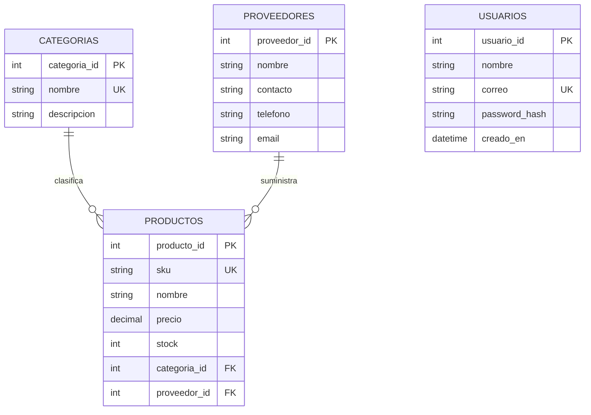

# Diagrama entidad-relación

Las cuentas de usuario son independientes del catálogo y almacenan únicamente
el hash de la contraseña.

Cada producto puede pertenecer a cero o una categoría y tener cero o un
proveedor asignado. Una categoría o un proveedor puede relacionarse con muchos
productos. Las relaciones son opcionales para permitir capturar el producto
antes de completar su clasificación o asignación.

El script de referencia está en [`backend/sql/schema.sql`](../backend/sql/schema.sql).
Solo crea tablas que no existan; revisa las tablas actuales antes de ejecutarlo,
ya que no modifica columnas ni agrega claves foráneas a tablas preexistentes.
